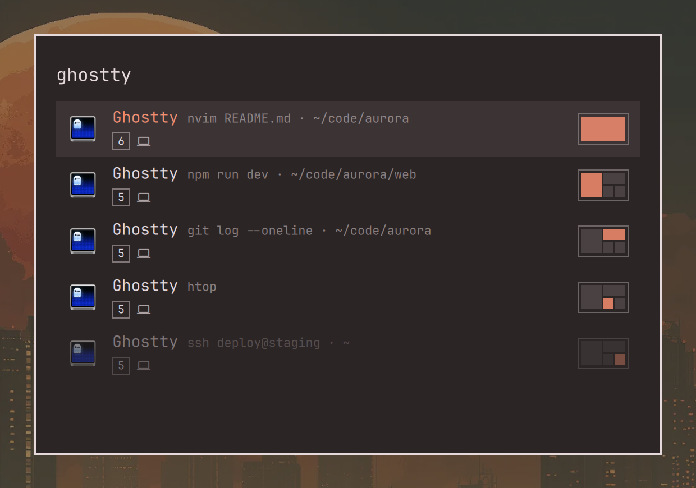
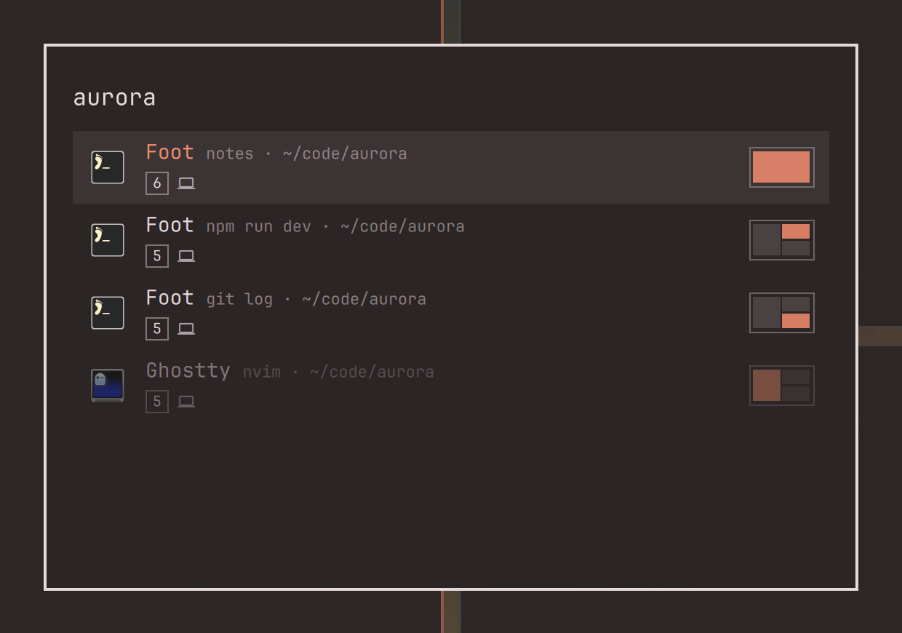
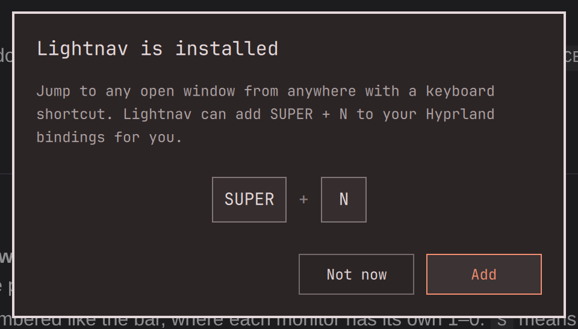

# Lightnav

**Jump to any open window in a couple of keystrokes, wherever it is: another workspace, another monitor, the scratchpad.**

Press `SUPER + N`, type a few letters of the app, press Enter. Lightnav switches to the right workspace and monitor and focuses the window.



## Why

With ten workspaces per monitor and a few terminals, browsers and editors spread across them, it's easy to forget where a window went. `ALT + TAB` cycles through windows one at a time, and `SUPER + 1…0` only helps if you remember the workspace. Lightnav shows you **all your open windows in one list** and takes you to the one you want, wherever it is.

It only lists windows that are open right now. It doesn't launch apps; that's what the Omarchy menu (`SUPER + SPACE`) is for.

## What you see

Each row is one open window:

- **App name**, as the app calls itself, and the **window title** next to it. For a terminal that's usually the running command and the folder; for a browser, the page.
- **Workspace number** in a small square, numbered like the bar, where each monitor has its own 1–0. `S` means the scratchpad or a minimized window.
- **Laptop or monitor icon**, showing whether the window is on the built-in display or an external monitor.
- **Layout miniature** on the right: the windows of that workspace drawn to scale, with this one highlighted. You can tell at a glance whether it's the big window on the left or the small one at the bottom.

The window you're in right now is dimmed.

## Finding windows

Without a search, all your windows are listed **largest first**, whatever the app. A window filling the whole screen is usually the one you're working in, and a small panel in the corner is usually a log or a monitor. Windows of the same size follow reading order: top to bottom, then left to right.

### By app name

Type part of the app name: `ghos` for Ghostty, `bra` for Brave. Exact matches come first, then names that start with what you typed, then names containing it anywhere.

When an app has several windows, they follow the same rule: the largest comes first.

### By what's in the window

The search also looks at window titles, so you can find a window by **what it's showing** instead of which app it is:

- a project folder (`aurora`) finds every terminal and editor working in it
- a running command (`npm`, `ssh`, `htop`) finds the terminal that runs it
- a web page or document (`gmail`, `invoice`) finds the browser or editor that has it open



Matching ignores case and diacritics: `prohlizec` finds *Prohlížeč*.

## Keys

| Key | Action |
|---|---|
| Type | Filter the list |
| `↑` `↓`, `PageUp` `PageDown` | Move the selection |
| `Enter` or click | Go to the window |
| `Delete` | Close the selected window and stay in the list |
| `Esc` | Clear the search, then close Lightnav |

A minimized window comes back to the workspace you're on. `Delete` closes a window the same way `SUPER + W` does, so an app with unsaved work can still ask before closing.

## Install

Run this in a terminal:

```bash
omarchy plugin add https://github.com/smetak13/omarchy-lightnav.git --enable
```

A few seconds later, Lightnav offers to set up its keyboard shortcut:



Choose **Add** (or press `Enter`) and you're done: press `SUPER + N` anywhere to open Lightnav. It adds the shortcut to `~/.config/hypr/bindings.lua`, between two marked comment lines, and never changes the file without asking. If `SUPER + N` is already taken, it offers `SUPER + ALT + N` instead.

Lightnav stays loaded in the shell, so it opens instantly.

### Adding the shortcut yourself

If you chose **Not now**, Lightnav shows the command below and won't ask again. Run it whenever you want the shortcut:

```bash
echo 'o.bind("SUPER + N", "Lightnav", { panel = "smetak13.lightnav" })' >> ~/.config/hypr/bindings.lua && hyprctl reload
```

For a different key, change `SUPER + N` in the command.

### Remove

```bash
omarchy plugin remove smetak13.lightnav
```

Then delete the Lightnav shortcut from `~/.config/hypr/bindings.lua`. If Lightnav added it for you, it's the block between `-- >>> Lightnav shortcut` and `-- <<< Lightnav shortcut`.

## Development

Filtering, sorting, workspace numbering and the layout miniature live in `Model.js`. Run its tests with Node's built-in test runner:

```bash
node --test tests/
```

After editing the QML, run `omarchy restart shell`. Lightnav stays loaded, so it keeps the old code until the shell restarts.

## License

[MIT](LICENSE)
